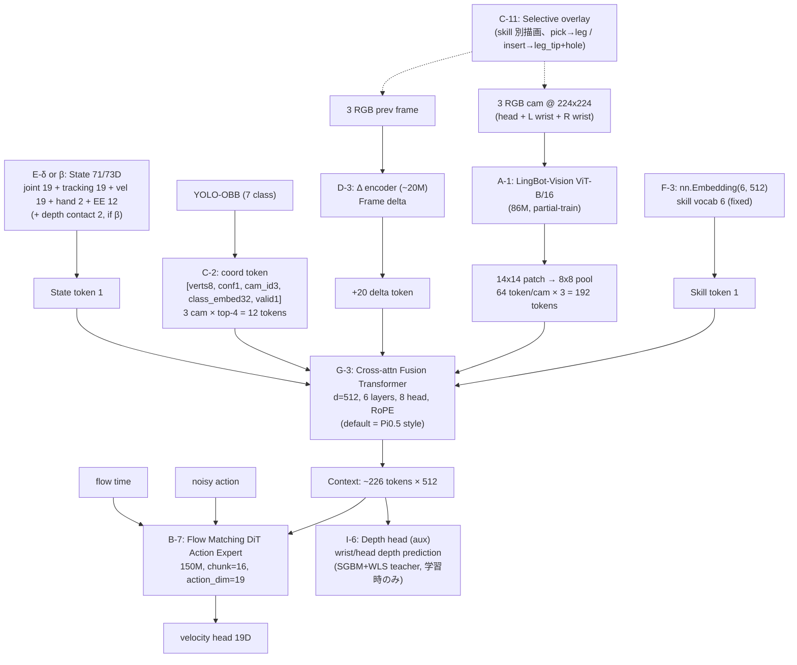

# RAMEN-Ori VLA (LingBot + OBB + Skill-lang) 設計 draft

Status: **draft / 議論中**、詳細詰めは今後
Author: Team RAMEN
Context: IROS 2026 IKEA Assembly Challenge、Unitree G1 + Dex1-1
参考 doc: [../dataset/dataset.md](../dataset/dataset.md)、[../../inference/README.md](../../inference/README.md)

---

## 1. 目的

IROS 2026 で **家具組立を実機で完走** させる policy stack を設計する。既存 subtask_policy_training が抱える Option A (ACT / DP / Flow Matching) と Option B (GR00T N1.7) に対し、**Option C を自作で構築し、Option D 構造の specialist として組み込む** 方向を検討する。

参考 doc の A/B/C/D 枠組み、および過去実績 (pi0.5 / GR00T の Team RAMEN dataset 上での fine-tune 難航) を踏まえ、**"本当に精度が出る" 方向** を選ぶ。

---

## 2. 実タスクフロー (基本形)

```
1. move_to_table  (walk、SDK 直呼び、policy 対象外)
    data 側では building_children_table

2. 4本 loop で:
    a. move_table_base (1回目) OR rotate_table_base (2-4回目)
       - move_table_base は move_to_table に入ってる or 存在しない場合あり
    b. pick_table_leg
    c. insert_table_leg
    d. rotate_leg_to_tighten

3. flip_table
```

**学習対象 (specialist policy) は 5 skill**:

| # | skill | 頻度 | 難易度 | 特徴 |
|---|---|---|---|---|
| 1 | `move_table_base` / `rotate_table_base` | ×4 | 低 | bimanual、非接触、天板回転 |
| 2 | `pick_table_leg` | ×4 | 中 | unimanual grasp |
| 3 | `insert_table_leg` | ×4 | **高** | bimanual contact-rich、leg_tip → hole 挿入 |
| 4 | `rotate_leg_to_tighten` | ×4 | **高** | bimanual 回転、socket engagement |
| 5 | `flip_table` | ×1 | **極高** | whole-body 反転動作 |

policy 外の処理:
- `move_to_table` (walk): `inference/desktop/lower_policy/skills/move_to_table.py` の SDK 直呼び
- recovery: rule-based (障害物検知 → home pose → 再試行)

**各 skill の accuracy が組立完走率に直結** (逐次 loop なので 1 skill 失敗で崩壊)。

---

## 3. アーキテクチャ選定: Option C (自作) を base とし Option D 構造で運用

### 3.1 参考 doc の 4 択とマッピング

| Option | 内容 | Team RAMEN での position |
|---|---|---|
| A | ACT / Diffusion Policy / Flow Matching + Vision frozen | 既存実装あり ([model/subtask_policy_training/](../../model/subtask_policy_training/))、**baseline として維持** |
| B | 大規模 VLA (GR00T / pi05) fine-tune | 既存実装あり、**Team RAMEN dataset で fine-tune 難航実績** |
| C | 小型 VLA 自作 (Foundation Vision + 軽量 LM + Flow DiT) | **本 doc の対象**、未実装 |
| D | Skill Library (階層 policy) | 既に採用構造 (`inference/desktop/skill_planner/` + `lower_policy/skills/`) |

### 3.2 Option C を採用する理由

**Past failure pattern** (Team RAMEN 特有):
- **pi0.5** (3.3B pretrained): Team RAMEN dataset での fine-tune 難航
- **GR00T N1.7** (3B pretrained): 実装完了しても勝ちに繋がらない

→ **large pretrained VLA を Team RAMEN dataset に fine-tune する path 全体が稼がない pattern** が 2 件観測されている。同じ path (SmolVLA fine-tune など) は risk 高。

**Data quality の観点**:
- Dataset B は 58h / 6.27M frames / ラボ環境 clean、~1,400 demo/skill 相当
- ACT / Diffusion Policy 系論文の実績 (100-500 clean demo で bimanual insert 可能) から、**from-scratch training に十分な data 量**
- pretraining に頼らずとも clean data + task 特化設計で精度が出る可能性が高い

**Task 特化設計の余地**:
- G1 の 19D action / 3 camera / bimanual は SmolVLA (SO-100 前提) や pi05 (7-DoF 前提) の default 契約と噛み合わない
- 自作なら最初から G1 に fit した契約 (action_dim, camera 構成, state augmentation) で設計可能

### 3.3 SmolVLA を fine-tune ではなく "architecture 参考" にする理由

**SmolVLA pretraining の domain gap**:

| 観点 | SmolVLA pretrain (SO-100/101) | Team RAMEN (G1 IKEA) | Gap |
|---|---|---|---|
| Action dim | 6-7 | 19 | 大 |
| Robot morphology | 6-DoF single arm tabletop | 43-DoF bimanual humanoid | **極大** |
| Task type | pick-and-place | contact-rich assembly | **極大** |
| Camera | 通常 single overhead | head stereo split + 両手首 | 大 |
| Contact | ほぼなし | insert / tighten で contact 主体 | **極大** |

→ **Action expert の pretraining は負転移リスクあり**。VLM 部分の学習済み特徴のみが微転移。**fine-tune で全体を触るよりは、architecture 設計を参考にしつつ自作で from-scratch train** の方が clean。

### 3.4 設計原則: Zero-from-scratch を default baseline とする (確定、2026-08-09 更新)

**原則**: **VLA 全体の pretrained (Pi0.5 / GR00T / SmolVLA 等) は使わない**、ただし **vision encoder 単体の pretrained model は使用可**。**Flow Matching (RECAP/OBB なし) を baseline** として成立させ、追加要素は baseline との差分で評価する。

**根拠**:
- 現代 VLA (Pi0.5 / SmolVLA / Qwen-VLA / LingBot-VLA 2.0) 全て Flow Matching 系 → 実務標準
- Team RAMEN Dataset B は ~1,400 demo/skill、Diffusion Policy (100-200 demo) の 7-14x → Flow Matching で成立見込み
- ACT (L1 regression) は uni-modal action 前提、Team RAMEN の multi-modal insertion angle と不適 → discard

**設計への implication**:
- 全 component は "VLA 全体の pretrained なしで成立" する設計を維持
- 追加要素 (LingBot / OBB / Aux head etc.) は "**Flow Matching baseline 比の上乗せ効果**" として評価
- 有意な上乗せがなければ、その追加要素は default から外す (Occam's razor)
- Component の "swappability" (LingBot なし fallback、OBB なし fallback、Language なし fallback) を必須要件とする

**axis 議論の結果 (2026-08-06〜08-09)**:
全 9 axis (A-I) の shortlist 確定完了。

---

## 4. RAMEN-Ori アーキテクチャ 具体設計 (draft、要 axis 別議論)

### 4.1 全体構成 (2026-08-09 更新、default 構成)



**構成要素の axis 対応**:
- A-1 LingBot (default) / A-2 RADIO (alternative) / A-4 V-JEPA 2 (conditional bundle)
- B-7 Flow Matching (default) / B-8 MeanFlow (alternative)
- C-2 OBB coord token + C-11 Selective overlay (併用可)
- D-3 Frame delta (default) / D-4 V-JEPA 2 (conditional with A-4)
- E-δ 71D (default) / E-β 73D (+depth contact bit)
- F-3 Skill embedding (default) / F-4 +Phase (Phase 2 拡張)
- G-3 Cross-attn (P1) / G-2 Interleaved (P2) / G-1 Standard (P3)
- H-4 Joint multi-task + H-3 curriculum + H-6 BC + H-7 AWR twist
- I-1 なし (baseline) / I-6 Depth (LingBot bundled) / I-5 Future frame (V-JEPA 2 bundled) / I-11 Dual-Query (Phase 4-5)

**done_prob head は削除** (Team RAMEN の subtask 単位切り出し data + skill_planner の enter_conditions で redundant)

### 4.2 参考アーキから盗む要素

| Reference | 盗む要素 | 捨てる要素 |
|---|---|---|
| [SmolVLA](https://huggingface.co/lerobot/smolvla_base) | interleaved attention、visual token 64 制限、Flow Matching action expert 設計、async inference、LeRobot integration | SigLIP、SO-100 pretrained weights、SO-100 hard-coded action_dim |
| [CogACT](https://cogact.github.io/) | dual vision encoder pattern、DiT action head 実装、shallow language conditioning | DINOv2 (LingBot 上位互換)、大 VLM |
| [Pi0.5](https://arxiv.org/abs/2504.16054) | Flow Matching real robot 実証設計、noise schedule / chunk 長 知見 | PaliGemma backbone、max_action_dim=32 の壁 |
| [ACT / DP](https://tonyzhaozh.github.io/aloha/) | action chunking baseline、bimanual 実証、clean data 勝ち例 | ResNet18 vision |
| [LingBot-Vision](https://arxiv.org/abs/2607.05247) | **boundary-centric SSL frozen backbone (core)**、depth prior、ViT-B/16 サイズ | (盗む全て) |

### 4.3 コンポーネント別仕様 (2026-08-09 更新、axis 確定反映)

以下は default 構成 + shortlist alternatives の要約。

**Vision backbone (A axis)**:
- **A-1 LingBot-Vision ViT-B/16 (default)** ([robbyant/lingbot-vision-vit-base](https://huggingface.co/robbyant/lingbot-vision-vit-base))、86M、**partial-train** (少し unfreeze で aux 効果最大化)
- 入力 224×224、14×14 patch → 8×8 spatial pool → 64 token/cam × 3 = 192 visual token
- Shortlist alternatives:
  - **A-2 RADIOv2.5-B** (NVIDIA agglomerative、OOD 汎化強): Phase 1 image mode bench 対抗馬
  - **A-4 V-JEPA 2 (ViT-L 300M)**: D-4 選択時のみ、temporal SSL の恩恵
- ViT-S/L の切替は compute 予算次第で調整

**Temporal Context (D axis)**:
- **D-3 Frame delta (default)**: 現在 `I_t` + 差分 `Δ_t = I_t - I_{t-1}` を **別 branch (small encoder ~20M)** で処理、Fusion に +20 delta token
- Backbone は frozen 保持可、latency ~18-20ms (30Hz 余裕)
- **D-4 Video encoder (V-JEPA 2, alternative)**: A-4 選択時に 16 frame の spatio-temporal 融合、latency 40ms

**Object Grounding (C axis)** (**optional、Phase 3 で "抜くか入れるか" 判定**):
- 既存 YOLO-OBB ([inference/desktop/perception/yolo_obb.py](../../inference/desktop/perception/yolo_obb.py))、7 class: workspace / leg / leg_tip / hole / table_top / hand_right / hand_left
- **C-2 coord token (default)**: 1 detection = 1 token、11 dim: verts (8) + conf (1) + cam_id one-hot (3) + valid mask (1) + class embedding (32、learnable)
- 3 camera × top-4 detection = **12 token**、padding + attention mask で無効化
- Sort by (class_id, -confidence) で permutation-invariance 崩す
- Detection dropout rate: 5% (第一候補)
- **C-11 Selective overlay (alternative)**: skill 別に "動かす対象 class" のみ描画 (pick→leg / insert→leg_tip+hole / etc.)、partial-train backbone との相乗効果、描画対象 final decide は着手時

**State augmentation (E axis)**:
- **E-δ 71D (default)**: joint 19D + tracking_err 19D (`q_desired - q_current`) + velocity 19D (2 frame 差分) + hand_state 2D + EE pose 12D → MLP → 1 state token
- **E-β 73D (alternative)**: E-δ + wrist depth contact bit 2D (`docs/dataset/depth.md` L2 SGBM+WLS heuristic derive、Phase 2 拡張)
- **前提**: **Dataset B に tau/torque/motor_current/force/effort 系 field 一切無し** (2026-08-08 実 parquet 確認済、`memory/dataset_b_no_feedback.md`)、force proxy は tracking_err + velocity + depth contact bit のみ

**Language Conditioning (F axis)**:
- **F-3 Skill embedding (default)**: `nn.Embedding(6, 512)` = 3K params、skill vocab 6 (fixed)
- **F-4 Skill + Phase (Phase 2 拡張)**: skill + phase (approaching/aligning/contacting) の dual embedding、phase 分割は skill_planner の enter_conditions を利用
- Full LM (SmolLM2 / T5 / CLIP text) は fixed 6 vocab で overkill、全 discard

**Fusion Transformer (G axis)**:
- **G-3 Cross-attn only (P1 default, Pi0.5 style)**: Fusion 内 self-attn 無し、Action Expert が Q、他 tokens が KV、最軽量 (240M FLOPs/layer)、frozen backbone 尊重
- **G-2 Interleaved (P2, SmolVLA style)**: 層別 vision-only self-attn と cross-attn 交互、modality 明示化バイアス強
- **G-1 Standard self-attn (P3, baseline)**: 全 token attend、最シンプル、debug 容易
- 共通: **d_model=512, 6 layer, 8 head, FFN=2048, RoPE** (LingBot backbone との一貫性)
- 入力 token: 192 (vision) + 20 (delta, D-3) + 12 (OBB) + 1 (state) + 1 (skill) = **~226 token**
- Phase 2 で 3 択 bench

**Action Expert (B axis)**:
- **B-7 Flow Matching DiT (default)**: 150M param、chunk = 16、action_dim = **19 (upper-body)**、Euler 積分 4-10 step
- **B-8 MeanFlow / MP1 (alternative)**: 30-100M、interval-averaged velocity で **1-step 6.8ms latency**、30Hz 完全達成
- Head: **velocity_head (19D) のみ** (`done_prob` head は削除、redundant で 2026-08-09 判定)
- Chunk 長 skill 別調整は Phase 3 で final decide

**Auxiliary Head (I axis)** (**backbone partial-train と bundle 必須**):
- **I-1 なし (Phase 1 baseline)**: pure BC、aux 効果検証の対象
- **I-6 Depth prediction (P1 default, A-1 LingBot bundled)**: Fusion context → wrist/head depth head → SGBM+WLS depth map or LingBot-Depth 2.0 teacher で supervision、L1 loss、offline batch で depth pre-compute
- **I-5 Future frame prediction (P1 alternative, A-4 V-JEPA 2 bundled)**: V-JEPA 2-AC predictor teacher、latent 空間の L2 loss
- **I-11 Dual-Query Distillation (P2 拡張, Phase 4-5)**: LingBot-VLA 2.0 SOTA recipe (Q_t + Q_{t+T} で depth + video の dual teacher)
- 全 aux head は **学習時のみ**、inference latency 影響ゼロ

### 4.4 総 params 見積 (2026-08-09 更新、A/B 選択別)

#### Default 構成 (A-1 LingBot + B-7 Flow Matching + D-3 Frame delta)

| module | params | trainable |
|---|---|---|
| LingBot ViT-B/16 (partial-train) | 86M | ~10M (partial) |
| Δ encoder (D-3) | ~20M | ~20M |
| Skill embedding (F-3) | 3K | 3K |
| OBB projection + class embed (C-2) | ~5M | ~5M |
| State projection (E-δ 71D) | ~1M | ~1M |
| Fusion transformer (G-3 or G-2 or G-1, d=512 × 6) | ~40M | ~40M |
| Action Expert (B-7 Flow DiT 150M) | 150M | 150M |
| Aux head (I-6 Depth, optional) | ~5M | ~5M |
| **合計 (aux 込み)** | **~307M** | **~231M** |

#### Alternative 構成 (A-4 V-JEPA 2 + B-8 MeanFlow + D-4 Video encoder)

| module | params | trainable |
|---|---|---|
| V-JEPA 2 ViT-L (partial-train) | 300M | ~30M (partial) |
| Skill embedding (F-3) | 3K | 3K |
| OBB projection (C-2) | ~5M | ~5M |
| State projection (E-δ 71D) | ~1M | ~1M |
| Fusion transformer (G-3 default) | ~40M | ~40M |
| Action Expert (B-8 MeanFlow) | ~50M | ~50M |
| Aux head (I-5 Future frame, optional) | ~2M | ~2M |
| **合計 (aux 込み)** | **~398M** | **~128M** |

**比較**:
- SmolVLA: 450M / trainable 450M
- Pi0.5: 3.3B
- GR00T N1.7: 3B

→ **default 構成 ~307M、alternative ~398M**、いずれも軽量。RTX 5090 で 30Hz 推論 (B-7 default で ~40ms 微超は async inference で緩和、B-8 MeanFlow で ~25ms 余裕)。

---

## 5. Skill 別 config (2026-08-09 更新、1 model + curriculum に方針変更)

**H-4 Joint multi-task train (1 policy for all skills、user 方針)** + **H-3 Skill-level curriculum (easy → hard) + H-5-alt Episode-level curriculum (prototype-first sampling)** で学習動態調整。

**同一 architecture + 同一 state schema (E-δ 71D)** で全 skill を 1 policy で扱う。skill_id conditioning (F-3) で分岐。

### Skill 別 chunk / executed (推論時)

| skill | chunk | executed | 補足 |
|---|---|---|---|
| `rotate_table_base` | 24 | 8 | 非接触、天板追跡 |
| `move_table_base` | 24 | 8 | 同上 |
| `pick_table_leg` | 24 | 6 | visual 主体、demo 豊富 |
| `insert_table_leg` | 12 | 3 | 100ms replan、contact 検知 (E-β の depth contact bit 有効) |
| `rotate_leg_to_tighten` | 16 | 4 | 回転 engagement 検知 (E-β の depth contact bit 有効) |
| `flip_table` | 24 | 8 | balance controller 委譲前提、whole-body 43D 拡張は Phase 4 塩漬け |

### Curriculum (H-3 + H-5-alt)

```
Step 1 (Phase 1、Week 1-2):
  move + rotate_base + pick のみ sample (easy skills)
  → shared representation の base 確立

Step 2 (Phase 2、Week 2-3):
  + insert + tighten (contact-rich 追加)
  → bottleneck 攻略、H-5-alt (episode-level prototype-first) の効果最大化

Step 3 (Phase 3、Week 3):
  + flip (whole-body 追加、全 skill 完成)
```

Step 遷移条件: 前 step の easy skill success rate > 閾値 (例 80%) で次 step へ遷移。

**skill 独立 train は方針変更で discard** (旧 design doc の "Option D specialist 純度" 記述は 2026-08-09 に user 方針で "1 model" に転換)。

---

## 6. 勝ち筋見立て (rough estimate)

各 skill の from-scratch 学習成功率の rough 見積:

| skill | RAMEN-Ori from-scratch | SmolVLA fine-tune (参考) | 備考 |
|---|---|---|---|
| rotate_table_base | 88% | 85% | 微優位 (SO-100 負転移なし) |
| move_table_base | 88% | 85% | 同上 |
| pick_table_leg | 85% | 88% | **SmolVLA 微優位** (SO-100 pick prior 微転移) |
| insert_table_leg | 65% | 55% | **RAMEN-Ori 大優位** (bimanual insert の負転移回避 + LingBot depth) |
| rotate_leg_to_tighten | 60% | 50% | 同上 |
| flip_table | 50% | 45% | 微優位 (whole-body 負転移なし) |

**総合完走率** (5 skill × 4 loop × flip、独立近似):
- RAMEN-Ori: 0.88^2 × 0.85 × 0.65 × 0.60 × 0.50 = **~13%**
- SmolVLA fine-tune: 0.85^2 × 0.88 × 0.55 × 0.50 × 0.45 = **~8%**

**RAMEN-Ori 側で ~1.6x**。ただしこれは "実装コスト無視、architecture のみでの差" の理論見積。

**Bottleneck** は明確に `insert_table_leg`、`rotate_leg_to_tighten`、`flip_table` の 3 skill。ここが 60% を超えないと総合完走率が 10% を切る。

---

## 7. 実装 phase 計画 (2026-08-09 更新、axis 確定反映)

### Phase 0: PoC 環境準備 (Week 1 前半)

- [ ] `model/ramen_ori/` pixi sub-workspace 作成 (torch + LeRobot、YOLO と同 pattern)
- [ ] HF weight access 確認 (LingBot-B, RADIO-B, YOLO-OBB, subtask datasets)
- [ ] YOLO-OBB を Dataset B 全 frame にオフライン推論、parquet に detection column 追加
- [ ] SGBM+WLS depth map を Dataset B 全 frame に pre-compute (I-6 用、~10 時間 GPU)
- [ ] RAMEN-Ori model class の skeleton 実装 (`model/ramen_ori/`)

### Phase 1: Minimum e2e (`pick_table_leg` BC train、Week 1-2)

**構成**: A-1 LingBot + D-3 Frame delta + C-2 OBB + E-δ 71D + F-3 Skill + **G-1 Standard self-attn (最軽量 baseline)** + B-7 Flow Matching + I-1 (aux 無し) + H-6 BC

- [ ] Data loader (Team-RAMEN `suzuki_pick_leg_1` の LeRobot load)
- [ ] LingBot-B frozen feature extractor
- [ ] OBB / State / Skill projection (各 1 token)
- [ ] Δ encoder (D-3、small ViT 20M)
- [ ] Fusion transformer (G-1 Standard で start)
- [ ] Action Expert (B-7 Flow Matching DiT chunk=16)
- [ ] BC training loop、pick_leg で 1 回学習完走
- [ ] Metric: valid split の joint L2 error、convergence 速度

### Phase 2: Contact-rich + Aux + Bench (Week 2-3)

- [ ] `insert_table_leg` 追加 (H-3 curriculum step 2)、H-5-alt episode-level curriculum 実装
- [ ] I-6 Depth prediction aux 追加 (LingBot bundled)、I-1 baseline との bench
- [ ] E-β (depth contact bit 2D) 追加、E-δ との bench
- [ ] H-7 AWR twist (sampler で weight) 実装、advantage 計算 (failure-retry + duration hybrid)
- [ ] A axis bench: LingBot vs RADIO (image mode)
- [ ] G axis bench: G-1 vs G-3 vs G-2

### Phase 3: 全 skill 並列 (Week 3 後半)

- [ ] H-3 curriculum step 3 (+ flip_table) で全 skill joint train
- [ ] B axis bench: Flow Matching vs MeanFlow (`insert_table_leg` で latency + 精度 対比)
- [ ] C axis ablation: C-2 vs C-1 (no grounding) で "YOLO 効果" 定量化
- [ ] H-5 difficulty-aware sampling を bottleneck skill 発動時に追加

### Phase 4: skill_planner 統合 + orchestrator E2E (Week 4)

- [ ] `inference/desktop/lower_policy/skills/` に RAMEN-Ori skill wrapper 実装
- [ ] Skill_planner の enter_conditions で skill 遷移判定 (policy done_prob 使わない、H-1 で redundant 確定)
- [ ] Offline replay で E2E smoke
- [ ] I-11 Dual-Query Distillation を bottleneck 未攻略時に追加検討

### Phase 5: 実機 sim-to-real 調整 (Week 5)

- [ ] Orin 側から RAMEN-Ori skill を呼び出し
- [ ] Camera domain gap (実機 mono head vs dataset stereo split) の吸収
- [ ] YOLO-OBB 実機動作確認
- [ ] Depth pipeline (SGBM+WLS) の実機 real-time 動作確認

### Phase 6: 予備 / 予選 (Week 6)

- [ ] 予備 buffer、fallback 対応、予選

### 競技外拡張 (RL post-training、Phase 5+ or 競技後)

- 実機 corrections データが収集できたら H-8 RECAP (Pi*0.6 recipe) 検討
- Sim environment が全 skill 分揃えば H-9 NFT / H-10 Flow-DPPO 検討
- 現状 (2026-08-09): Team RAMEN の real-only data + sim 不完全性で **RL 系は競技本番では走らせない判断**

---

## 8. 未決事項 (2026-08-09 更新、axis 確定分を close)

### 8.1 Architecture

- [x] ~~Fusion transformer の layer 数、head 数、interleaved attn パターン~~ → **G-3 Cross-attn only default (P1), G-2 Interleaved (P2), G-1 Standard (P3)、d=512/6L/8H、Phase 2 で 3 択 bench**
- [ ] Action Expert の noise schedule (linear / cosine / karras)、chunk 長の skill 別最終値
- [x] ~~Skill 内 phase 分割の要否~~ → **F-3 skill embedding default、F-4 skill+phase は Phase 2 拡張**
- [x] ~~Multi-frame observation の要否~~ → **D-3 Frame delta default、D-4 V-JEPA 2 (A-4 選択時) alternative**
- [x] ~~Depth / IR camera の入力設計~~ → **I-6 Depth prediction (aux target) + E-β (depth contact bit as state input) の 2 段活用**

### 8.2 学習 recipe

- [ ] Optimizer (AdamW default)、LR schedule
- [ ] Batch size (H100 80GB で最大化)
- [ ] Augmentation (image crop / color / detection dropout の詳細)
- [ ] EMA 使用の要否
- [ ] Split (train / val / test) の切り方 (現状 80/10/10 grouped by recording)
- [x] ~~Curriculum 戦略~~ → **H-4 Joint + H-3 Skill-curriculum + H-5-alt Episode-curriculum、H-6 BC + H-7 AWR twist**

### 8.3 State / Action 契約

- [ ] tracking_err の計算元 (q_desired vs q_current の frame タイミング)
- [ ] velocity の frame 差分 or FFT 系
- [ ] flip_table で 19D vs 43D の判断 → **Phase 4 塩漬け、初期は 19D 統一**
- [x] ~~Motor current が dataset に乗っているかの確認~~ → **確定的に無し、Dataset B に一切無し (2026-08-08 実 parquet 確認)、E-5 tau_est/motor_current は自動 discard**、詳細 `memory/dataset_b_no_feedback.md`

### 8.4 OBB integration

- [ ] Class embedding 次元 (32 default、要 tuning)
- [ ] Top-K detection の K 値 (現状 12、要調整)
- [ ] Detection dropout rate (現状 5% default、bench で決定)
- [ ] IR camera の OBB 利用可否 (現状 RGB のみ)
- [x] ~~OBB integration 方式~~ → **C-2 coord token default + C-11 Selective overlay (partial-train backbone bundle)**、Phase 3 で "C 自体を抜くか" ablation で判定

### 8.5 Evaluation

- [ ] Skill 別 success rate の定義 (frame-based / trajectory-based)
- [ ] Bench dataset の切り方 (recording 単位、Phase 別)
- [ ] Ablation 対象 (backbone / OBB / state aug / language 各要素)
- [x] ~~Advantage 計算方法 (H-7 AWR twist 用)~~ → **Dataset A の failure-retry pattern (docs/dataset/dataset.md §7 提案済み) + Dataset B の subtask duration 分析の hybrid、2-3 日実装**

### 8.6 Deploy

- [ ] Inference latency budget (30Hz replan、200ms chunk 実行)
- [ ] Model 量子化の要否 (bfloat16 default、INT8 は未検討)
- [ ] Multi-skill を 1 process で hold vs skill 切替時に load → **1 policy 前提 (H-4)、切替不要**

### 8.7 Fallback 分岐

- [x] ~~Phase 1 で SmolVLA が RAMEN-Ori を大きく上回った場合の方針転換手順~~ → **RAMEN-Ori 主軸で確定、bench 対象は shortlist alternatives (A-2 RADIO, B-8 MeanFlow, G-2 Interleaved etc.)**
- [ ] Phase 2 で contact-rich が train しない場合の古典制御化判断基準
- [ ] Phase 4 の実機 sim-to-real で YOLO 精度落ちた場合の対応
- **競技外拡張**: 実機 corrections データ収集後 or 競技後、H-8 RECAP (Pi*0.6) or H-9 NFT (MeanFlowNFT) の RL post-training 検討

---

## 9. 関連 doc / 参考

- Dataset 詳細: [../dataset/dataset.md](../dataset/dataset.md)
- 現 Inference 設計: [../../inference/README.md](../../inference/README.md)
- 現 subtask_policy_training: [../../model/subtask_policy_training/README.md](../../model/subtask_policy_training/README.md)

### 参考実装

- [SmolVLA (LeRobot)](https://huggingface.co/lerobot/smolvla_base) — architecture 参考
- [CogACT](https://cogact.github.io/) — dual vision pattern 参考
- [Pi0.5](https://arxiv.org/abs/2504.16054) — Flow Matching 参考
- [LingBot-Vision (Ant Group)](https://huggingface.co/robbyant/lingbot-vision-vit-base) — vision backbone
- [ACT (Aloha bimanual)](https://tonyzhaozh.github.io/aloha/) — bimanual baseline 参考

---

## 10. 変更履歴

- **2026-07-17**: 初版 draft、RAMEN-Ori from-scratch 方針、5 skill specialist 構成で作成
- **2026-08-06**: §3.4 追加 (Zero-from-scratch を default baseline とする原則、確定)。§4 の "RAMEN-Ori 具体設計" は draft のままで、axis 別議論の結果で更新予定と明記
- **2026-08-09**: **全 9 axis (A-I) の shortlist 確定** を反映。主要変更:
  - §3.4 "ACT baseline" → "Flow Matching baseline" に更新
  - §4.1 全体構成図: D-3 Frame delta / C-11 Selective overlay / I-6 Depth aux 追加、done_prob head 削除
  - §4.3 各 component spec を axis 確定 (A/B/C/D/E/F/G/H/I) に応じて全 update
  - §4.4 params 見積を A/B 選択別 (default LingBot+Flow ~307M / alt V-JEPA 2+MeanFlow ~398M) に table 化
  - §5 skill 別 config を "H-4 Joint + H-3/H-5-alt curriculum" に転換 (旧 "skill 独立 train" は方針変更で discard)
  - §7 Phase 計画に A-I の bench 対比を統合 (Phase 1 minimum e2e → Phase 2 contact-rich + aux + bench → Phase 3 全 skill 並列 → Phase 4-5 実機統合)、RL post-training は競技外拡張として位置付け
  - §8 backlog を axis 確定分で close (Motor current 無し確定、Fusion attn pattern 確定、Multi-frame 確定 etc.)
  - **Dataset B に tau/torque/motor_current/force/effort 系 field 一切無し** (2026-08-08 実 parquet 確認、`memory/dataset_b_no_feedback.md` に記録) を §4.3 State 節と §8.3 に反映
