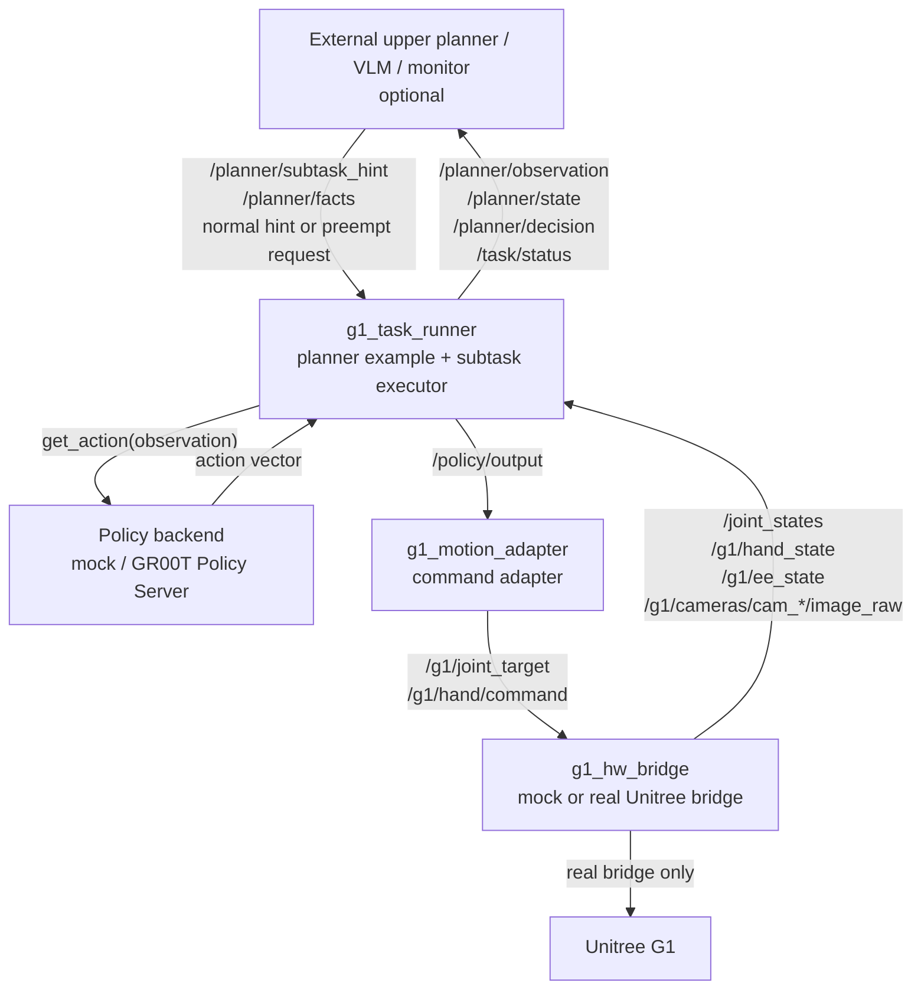
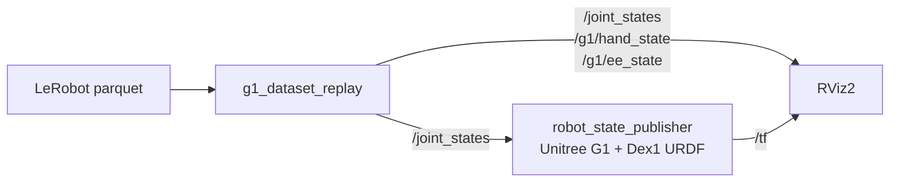

# ROS2 System Reference (topology γ 前提で書かれた元設計 doc)

> **Status**: 本 doc は初期に書かれた ROS2 system 設計 doc。当時は topology γ (Docker 内に ROS2 全部入れ + `g1_task_runner` + `g1_motion_adapter` chain) を前提。
>
> 現在は **topology β** (Desktop = pixi + cyclonedds direct、Orin = I/O layer) に決定済 → **`g1_task_runner` / `g1_motion_adapter` は `_deprecated/` に隔離**。deploy guide (topology β 準拠) は [`README.md`](README.md) を参照。去就は Phase 2 #B-2 で判断予定。
>
> 以下は **Orin 側 ROS2 package の設計・topic contract・GR00T observation の詳細を知るための reference** として保持 (`g1_bringup` / `g1_hw_bridge` / `g1_description` / `g1_msgs` / `g1_dataset_replay` の説明は流用可、mermaid の `task_runner` chain は topology γ 遺物)。

---

# RAMEN Inference ROS 2 System

`iros_2026_ramen/inference` は、Humanoid IKEA Assembly Challenge 向けの Unitree G1 推論パイプラインです。ROS 2 Humble + Docker で動かす前提で、データ取得は含めません。

このREADMEは現在のROS 2実装を説明します。実行対象は主に `src/` 以下のROS 2 packages、`Dockerfile`、`docker-compose.yml`、`scripts/docker_entrypoint.sh` です。`logic_wrapper/` などの旧Python実装は現在のlaunchからは使っていません。

## 現在の実装範囲

| 項目 | 状態 |
|---|---|
| ROS 2 | Humble |
| Docker | `osrf/ros:humble-desktop` ベース |
| 対象ロボット | Unitree G1 + Dex1 hand想定 |
| サブタスク | `move_to_work_pose`, `pick_leg`, `coarse_insert`, `flip_table` |
| 上位planner | `rule_based` exampleを `g1_task_runner` 内に同梱。外部VLM/plannerは `/planner/observation` から判断可能 |
| 実行中割り込み | `/planner/subtask_hint` または `/planner/facts` でpreempt可能 |
| policy backend | `mock`, `gr00t` client example |
| 標準action layout | `robot_q36_hand2` のみ |
| 画像入力 | `observation.images.cam_0..cam_3` をRGB8 480x640で購読 |
| 実機I/O | `g1_hw_bridge` はmock。実機ではUnitree bridgeへ差し替え |
| dataset replay | LeRobot parquetを `/joint_states` へreplayしRVizで確認 |

## Package構成

```text
src/
  g1_msgs/            # PolicyOutput.msg
  g1_task_runner/     # planner, subtask executor, policy backend呼び出し
  g1_motion_adapter/  # PolicyOutput -> /g1/joint_target, /g1/hand/command
  g1_hw_bridge/       # mock hardware bridge
  g1_dataset_replay/  # LeRobot parquet replay
  g1_description/     # Unitree G1 + Dex1 URDF, meshes, RViz config
  g1_bringup/         # launchとsystem.yaml
```

## 構成図



`rule_based` plannerはexampleとして `g1_task_runner` 内にあります。VLM、Behavior Tree、FSM、別プロセスの監視ノードを使う場合は `/planner/observation` を購読し、判断結果を `/planner/subtask_hint` または `/planner/facts` にpublishします。

## Quick Start

```bash
cd ~/gitrepo/iros_2026_ramen/inference
docker compose build
```

mock hardware込みで自動実行します。

```bash
docker compose run --rm ramen_inference \
  ros2 launch g1_bringup system.launch.py auto_start_task:=true
```

起動だけして手動で開始する場合:

```bash
docker compose run --rm ramen_inference \
  ros2 launch g1_bringup system.launch.py
```

別terminalから:

```bash
docker compose run --rm ramen_inference \
  ros2 service call /task/start std_srvs/srv/Trigger {}
```

期待するログの例:

```text
task runner ready: 4 subtasks
accepted joint target
accepted hand command
task_succeeded
```

## Launch

`system.launch.py` は次のノードを起動します。

| node | package | 役割 |
|---|---|---|
| `g1_task_runner` | `g1_task_runner` | subtask選択、policy呼び出し、`/policy/output` publish |
| `g1_motion_adapter` | `g1_motion_adapter` | `PolicyOutput` をG1 command topicへ変換 |
| `g1_mock_hw_bridge` | `g1_hw_bridge` | mock state/image publishとmock command受信 |

主なlaunch引数:

| 引数 | 既定値 | 意味 |
|---|---|---|
| `auto_start_task` | `false` | launch後にtaskを自動開始 |
| `mock_hardware` | `true` | mock bridgeを起動。実機bridgeを別で動かす場合は `false` |
| `planner_mode` | `rule_based` | `rule_based`, `vlm_hint`, `vlm_only` |
| `planner_observation_rate_hz` | `5.0` | `/planner/observation` publish周期。`0.0` で無効 |

設定本体は [system.yaml](ros2_ws/src/g1_bringup/config/system.yaml) にあります。

## 実機推論パイプライン

実行時の流れは次です。

1. 実機bridgeまたはmock bridgeが状態と画像をpublishします。
2. `g1_task_runner` が `/joint_states`, `/g1/hand_state`, `/g1/ee_state`, `/g1/cameras/cam_*/image_raw` を保持します。
3. `/task/start` または `auto_start_task:=true` でtaskを開始します。
4. 上位plannerが次の `skill_id` を決めます。外部plannerは `/planner/observation` のstate、候補subtask、factsを根拠に判断できます。デフォルトは内蔵 `rule_based` exampleです。
5. `skill_id` に対応する `policy_id` を `subtask_specs` から引きます。
6. `policy_specs_json` のbackendに従って `mock` または `gr00t` を呼びます。
7. backendのaction vectorを `PolicyOutput` に変換して `/policy/output` へpublishします。
8. `g1_motion_adapter` が下半身jointをmaskし、制御対象jointだけを `/g1/joint_target` に、hand commandを `/g1/hand/command` にpublishします。
9. 実機bridgeがUnitree側の制御APIへ渡します。mock時は内部状態を更新するだけです。
10. subtask成功後にfactsを更新し、plannerが次のsubtaskを選びます。

現在の成功判定は簡易実装です。各subtaskは `policy_steps` 回actionをpublishすると成功扱いになります。実機ではVLM、接触判定、把持判定、姿勢判定などから `/planner/facts` を更新し、状況判断を置き換えてください。

## Subtask

現在のサブタスクは4つだけです。

```text
move_to_work_pose
pick_leg
coarse_insert
flip_table
```

`subtask_specs` は固定シーケンスではなく、plannerが選択できるsubtask定義です。

```yaml
subtask_specs:
  - move_to_work_pose|work_pose_01|move to the work pose in front of the table top|move_to_work_pose|1|
  - pick_leg|next_leg|pick up the next table leg with both hands as needed|pick_leg|1|
  - coarse_insert|next_leg|coarsely insert and twist the held table leg into the table top|coarse_insert|1|
  - flip_table|table_top|flip the table to the upright pose after all legs are inserted|flip_table|1|
```

形式:

```text
skill_id|target|instruction|policy_id|max_attempts|on_failure_skill
```

`rule_based` exampleはfactsから次を選びます。

| 条件 | 選択 |
|---|---|
| `at_work_pose=false` | `move_to_work_pose` |
| `inserted_leg_count < required_leg_count` かつ `holding_leg=false` | `pick_leg` |
| `inserted_leg_count < required_leg_count` かつ `holding_leg=true` | `coarse_insert` |
| `table_flipped=false` | `flip_table` |
| すべて完了 | `task_succeeded` |

初期factsでは結果的に次のように進みます。

```text
move_to_work_pose
pick_leg -> coarse_insert
pick_leg -> coarse_insert
pick_leg -> coarse_insert
pick_leg -> coarse_insert
flip_table
```

これは内蔵exampleの結果であり、実装上は常にシーケンシャル固定ではありません。

## 上位Plannerと割り込み

`planner_mode`:

| mode | 挙動 |
|---|---|
| `rule_based` | 内蔵rule-based exampleだけで選択 |
| `vlm_hint` | 新しい `/planner/subtask_hint` を優先し、無効ならrule-basedへfallback |
| `vlm_only` | 有効なhintがない場合はtask failed |

外部planner/VLM/監視ノードは `/planner/observation` を購読して、subtask policyと同じstate入力を根拠に判断できます。

`/planner/observation` は `std_msgs/msg/String` のJSONです。主要フィールド:

| field | 内容 |
|---|---|
| `observation["observation.state.robot_q_current"]` | `/joint_states` 由来の36次元state |
| `observation["observation.state.hand_state"]` | `/g1/hand_state` 由来の2次元state |
| `observation["observation.state.ee_state"]` | `/g1/ee_state` 由来の12次元state |
| `state_vector` | `robot_q_current + hand_state + ee_state` の50次元vector |
| `candidate_subtasks` | `skill_id`, `policy_id`, `instruction`, `preconditions_ok`, `done` |
| `active_step` | 現在実行中の `skill_id`, `policy_id`, `target` |
| `facts` | 現在のplanner facts |
| `image_observation` | `observation.images.cam_0..3` のRGB8画像メタデータ。設定によりbase64 payloadも含める |

抜粋例:

```json
{
  "event": "planner_observation",
  "observation_layout": "robot_q36_hand2",
  "state_dim": 50,
  "active_step": {"skill_id": "pick_leg", "policy_id": "pick_leg", "target": "next_leg"},
  "observation": {
    "observation.state.robot_q_current": [0.0, 0.0],
    "observation.state.hand_state": [0.8, 0.8],
    "observation.state.ee_state": [0.0, 0.0]
  },
  "candidate_subtasks": [
    {"skill_id": "coarse_insert", "policy_id": "coarse_insert", "preconditions_ok": true, "done": false}
  ]
}
```

配列は実際には `robot_q_current=36`, `hand_state=2`, `ee_state=12` です。画像はdatasetと同じ `observation.images.cam_0..cam_3` keyで扱い、内部ではRGB `uint8[480, 640, 3]` に正規化します。`/planner/observation` では通常は画像メタデータのみを出し、`planner_observation_include_image_data: true` の場合だけ `data_b64` にRGB bytesをbase64で載せます。

外部planner/VLM/監視ノードはfactsを更新できます。

```bash
ros2 topic pub --once /planner/facts std_msgs/msg/String \
  "{data: '{\"at_work_pose\": true, \"holding_leg\": true, \"inserted_leg_count\": 2}'}"
```

次subtaskのhintも渡せます。

```bash
ros2 topic pub --once /planner/subtask_hint std_msgs/msg/String \
  "{data: '{\"skill_id\": \"coarse_insert\", \"confidence\": 0.91, \"source\": \"vlm\"}'}"
```

plain textも受け付けます。

```bash
ros2 topic pub --once /planner/subtask_hint std_msgs/msg/String "{data: coarse_insert}"
```

subtask実行中でも、上位plannerや監視ノードは別subtaskへ割り込めます。`g1_task_runner` は各policy tickの先頭でpreempt要求を確認し、要求が有効なら現在subtaskを成功扱いにせず中断します。

hint経由:

```bash
ros2 topic pub --once /planner/subtask_hint std_msgs/msg/String \
  "{data: '{\"skill_id\":\"move_to_work_pose\",\"preempt\":true,\"reason\":\"lost_work_pose\",\"source\":\"monitor\"}'}"
```

facts経由:

```bash
ros2 topic pub --once /planner/facts std_msgs/msg/String \
  "{data: '{\"failure_detected\":true,\"recovery_skill_id\":\"move_to_work_pose\",\"failure_reason\":\"insert_pose_unstable\"}'}"
```

preempt要求は消費型です。受理またはrejectされた要求は内部hint/factsから削除され、同じ要求が毎tick繰り返されないようにしています。

主なstatus:

| event | 意味 |
|---|---|
| `step_preempted` | 現在subtaskを中断し、指定subtaskへ切り替え |
| `preempt_rejected` | 指定subtaskまたはpolicyが存在しない |
| `preempt_ignored` | 実行中と同じ `skill_id` へのpreempt |

割り込みの反応粒度は `step_period_sec` です。デフォルトは `0.2` 秒です。

## Policy / Dataset Contract

現在の標準layoutは `robot_q36_hand2` だけです。

| dataset field | 次元 | runtime入力/出力 |
|---|---:|---|
| `observation.state.robot_q_current` | 36 | `/joint_states` |
| `observation.state.hand_state` | 2 | `/g1/hand_state` |
| `observation.state.ee_state` | 12 | `/g1/ee_state` |
| `observation.images.cam_0` | 480x640x3 RGB | `/g1/cameras/cam_0/image_raw` |
| `observation.images.cam_1` | 480x640x3 RGB | `/g1/cameras/cam_1/image_raw` |
| `observation.images.cam_2` | 480x640x3 RGB | `/g1/cameras/cam_2/image_raw` |
| `observation.images.cam_3` | 480x640x3 RGB | `/g1/cameras/cam_3/image_raw` |
| `action.robot_q_desired` | 36 | `g1_motion_adapter` で下半身をmask後、`/g1/joint_target` |
| `action.hand_cmd` | 2 | `/g1/hand/command` |

標準state/action次元:

```text
state_dim  = robot_q_current(36) + hand_state(2) + ee_state(12) = 50
action_dim = robot_q_desired(36) + hand_cmd(2) = 38
```

公開datasetのベース:

```text
BitRobot/G1_WBT_Dex1_Building-Children-Table
```

サブタスク別LeRobot datasetに差し替える場合は、`policy_specs_json` の該当policyで次を合わせます。

| key | 意味 |
|---|---|
| `dataset_repo_id` | サブタスクのdataset repo |
| `lerobot_video_keys` | 学習に使った画像key |
| `lerobot_state_keys` | 学習に使ったstate key |
| `lerobot_action_keys` | 学習に使ったaction key |
| `robot_q_dim`, `hand_dim`, `ee_dim` | 各ベクトル次元 |
| `state_dim`, `action_dim` | backend入出力次元 |
| `action_layout` | 現在は `robot_q36_hand2` |

`PolicyOutput`:

| field | 内容 |
|---|---|
| `policy_id` | 実行したpolicy |
| `command_type` | `joint_trajectory` または `hold` |
| `joint_trajectory` | policy由来の関節target。adapterで制御対象jointだけにfilterされる |
| `hand_command` | 2次元hand command |
| `confidence` | 現在はログ/診断用 |
| `status` | `running` など |
| `diagnostics` | backend、dataset key、targetなど |

`g1_motion_adapter` は `command_type=joint_trajectory` のときだけcommandを出します。`hold` または空文字は無視します。未知の `command_type` はwarnして捨てます。

### 下半身制御

実機ではG1標準の下半身制御を使う前提にしています。policyはdataset contractに合わせて36次元の `action.robot_q_desired` を出せますが、`g1_motion_adapter` が下半身jointを除外してから `/g1/joint_target` にpublishします。観測側の `/joint_states` は全身のままなので、上位plannerとpolicyは下半身状態を参照できます。

デフォルトでは `g1_joint_00..g1_joint_11` を下半身leg jointsとしてcommand対象から外します。

```yaml
g1_motion_adapter:
  ros__parameters:
    blocked_joint_names:
      - g1_joint_00
      - g1_joint_01
      # ...
      - g1_joint_11
    controlled_joint_names: []
```

`controlled_joint_names` を指定した場合は、そのリストに含まれ、かつ `blocked_joint_names` に含まれないjointだけをpublishします。実機bridge側では、Unitree標準下半身制御を有効にしたまま、`/g1/joint_target` を上半身/torso/hand側のcommandとして扱ってください。

画像topicは `image_topics_json` で変更できます。既定値:

```json
{
  "observation.images.cam_0": "/g1/cameras/cam_0/image_raw",
  "observation.images.cam_1": "/g1/cameras/cam_1/image_raw",
  "observation.images.cam_2": "/g1/cameras/cam_2/image_raw",
  "observation.images.cam_3": "/g1/cameras/cam_3/image_raw"
}
```

入力encodingは `rgb8`, `bgr8`, `rgba8`, `bgra8`, `mono8` に対応し、`g1_task_runner` 内でRGB8へ変換します。サイズが480x640以外の場合はnearest neighborで `observation_image_height` x `observation_image_width` に合わせます。

## GR00T-N1.7 Example

`coarse_insert` は `backend: gr00t` のexampleです。ただしデフォルト設定では次の通りです。

```yaml
backend: gr00t
enabled: false
fail_without_model: false
```

そのため通常のDocker smoke runではGR00Tを呼ばず、mock actionへfallbackします。Docker imageにはGR00T本体は含めていません。

GR00Tを使う場合は、外部でGR00T Policy Serverを起動し、`policy_specs_json` の `coarse_insert` を変更します。

```json
{
  "policy_id": "coarse_insert",
  "skill_id": "coarse_insert",
  "backend": "gr00t",
  "enabled": true,
  "fail_without_model": true,
  "checkpoint": "nvidia/GR00T-N1.7-3B",
  "host": "127.0.0.1",
  "port": 5555,
  "action_layout": "robot_q36_hand2",
  "state_dim": 50,
  "action_dim": 38
}
```

`g1_task_runner` のGR00T observationは、robot/hand/ee stateと `observation.images.cam_0..cam_3` の最新RGB画像から作ります。まだ画像topicを受信していないkeyはzero imageにfallbackします。

## Dataset Replay / RViz

LeRobot parquetをreplayし、G1の姿勢をRVizで確認できます。



datasetをホスト側に置きます。

```bash
mkdir -p ~/datasets/G1_WBT_Dex1_Building-Children-Table/data/chunk-000
```

RVizあり:

```bash
cd ~/gitrepo/iros_2026_ramen/inference
xhost +local:docker
docker compose run --rm \
  -v ~/datasets:/workspace/datasets \
  ramen_inference \
  ros2 launch g1_bringup dataset_replay_rviz.launch.py \
    parquet_file:=/workspace/datasets/G1_WBT_Dex1_Building-Children-Table/data/chunk-000/file-011.parquet \
    frame_stride:=3 \
    loop:=true \
    rviz:=true
```

ヘッドレス確認:

```bash
docker compose run --rm \
  -v ~/datasets:/workspace/datasets \
  ramen_inference \
  ros2 launch g1_bringup dataset_replay_rviz.launch.py \
    parquet_file:=/workspace/datasets/G1_WBT_Dex1_Building-Children-Table/data/chunk-000/file-011.parquet \
    max_frames:=300 \
    loop:=false \
    rviz:=false
```

action側をreplayする場合:

```bash
ros2 launch g1_bringup dataset_replay_rviz.launch.py \
  parquet_file:=/workspace/datasets/G1_WBT_Dex1_Building-Children-Table/data/chunk-000/file-011.parquet \
  use_action:=true \
  frame_stride:=3
```

主なlaunch引数:

| 引数 | 既定値 | 意味 |
|---|---|---|
| `dataset_root` | `/workspace/datasets/G1_WBT_Dex1_Building-Children-Table` | dataset root |
| `parquet_file` | empty | 直接読むparquet。指定時は `dataset_root` より優先 |
| `urdf_file` | `unitree_g1/g1_29dof_mode_15_with_dex1_1.urdf` | `g1_description/urdf` からの相対path |
| `episode_index` | `-1` | episode filter。`-1` は全frame |
| `use_action` | `false` | `false`: observation replay、`true`: action replay |
| `frame_stride` | `1` | 間引き |
| `max_frames` | `0` | 最大frame数。`0` は制限なし |
| `loop` | `true` | 末尾後に先頭へ戻る |
| `rviz` | `true` | RViz2を起動 |

標準URDFはUnitree公式 `g1_29dof_mode_15_with_dex1_1.urdf` を同梱しています。URDF上の可動jointは33個です。datasetの `robot_q_current` は36次元想定なので、RViz replayではlaunch内の `UNITREE_G1_DEX1_JOINT_NAMES` に先頭から割り当てます。正式なdataset joint orderが確定したら [dataset_replay_rviz.launch.py](ros2_ws/src/g1_bringup/launch/dataset_replay_rviz.launch.py) を更新してください。

## Topic / Service

通信はROS 2 Actionではなく、streaming command/stateをpub/sub、task lifecycleをTrigger serviceで扱います。subtaskごとにAction Serverを立てる構成にはしていません。

| name | type | 方向 | 役割 |
|---|---|---|---|
| `/task/start` | `std_srvs/srv/Trigger` | service | task開始 |
| `/task/stop` | `std_srvs/srv/Trigger` | service | task停止要求 |
| `/task/reset` | `std_srvs/srv/Trigger` | service | planner factsとauto-start状態をreset |
| `/task/status` | `std_msgs/msg/String` | pub | JSON status |
| `/planner/facts` | `std_msgs/msg/String` | sub | 外部planner/認識器からのfacts入力 |
| `/planner/subtask_hint` | `std_msgs/msg/String` | sub | 外部planner/VLMからのhint/preempt入力 |
| `/planner/observation` | `std_msgs/msg/String` | pub | 外部planner/VLM向けのpolicy相当observation JSON |
| `/planner/state` | `std_msgs/msg/String` | pub | 現在facts |
| `/planner/decision` | `std_msgs/msg/String` | pub | 選択subtask |
| `/policy/output` | `g1_msgs/msg/PolicyOutput` | pub | policy action |
| `/motion/accepted_output` | `g1_msgs/msg/PolicyOutput` | pub | adapterが受理したaction |
| `/joint_states` | `sensor_msgs/msg/JointState` | sub/pub | 標準robot state |
| `/g1/hand_state` | `std_msgs/msg/Float32MultiArray` | sub/pub | 2D hand state |
| `/g1/ee_state` | `std_msgs/msg/Float32MultiArray` | sub/pub | 12D EE state |
| `/g1/cameras/cam_0/image_raw` | `sensor_msgs/msg/Image` | sub/pub | `observation.images.cam_0` RGB image |
| `/g1/cameras/cam_1/image_raw` | `sensor_msgs/msg/Image` | sub/pub | `observation.images.cam_1` RGB image |
| `/g1/cameras/cam_2/image_raw` | `sensor_msgs/msg/Image` | sub/pub | `observation.images.cam_2` RGB image |
| `/g1/cameras/cam_3/image_raw` | `sensor_msgs/msg/Image` | sub/pub | `observation.images.cam_3` RGB image |
| `/g1/joint_target` | `trajectory_msgs/msg/JointTrajectory` | pub/sub | adapterでfilter済みの制御対象joint target |
| `/g1/hand/command` | `std_msgs/msg/Float32MultiArray` | pub/sub | 2D hand command |
| `/g1/motion_enable` | `std_msgs/msg/Bool` | sub | mock bridgeのmotion enable |
| `/g1/replay/status` | `std_msgs/msg/String` | pub | dataset replay status |

命名規則:

| 種類 | 例 | 方針 |
|---|---|---|
| ROS標準topic | `/joint_states` | RViz、robot_state_publisher等との互換を優先し `/g1` を付けない |
| G1固有topic | `/g1/hand_state`, `/g1/joint_target`, `/g1/cameras/cam_0/image_raw` | G1/RAMEN固有I/Oなので `/g1/...` |
| pipeline内部topic | `/task/status`, `/planner/decision`, `/policy/output` | ロボット非依存の推論制御面 |

## 実機Bridge差し替え

`g1_hw_bridge` はmockです。実機では `mock_hardware:=false` で起動し、別プロセスのUnitree bridgeが同じI/O契約を満たすようにします。

推論側への入力:

```text
/joint_states
/g1/hand_state
/g1/ee_state
/g1/cameras/cam_*/image_raw
```

推論側からの出力:

```text
/g1/joint_target
/g1/hand/command
```

`/g1/joint_target` はfull-body commandではなく、`g1_motion_adapter` のjoint filterを通過した制御対象jointだけを含みます。下半身はG1標準制御側が所有する前提です。

Unitree `unitree_ros2` 等と接続する場合は、CycloneDDSと実機NICの設定が必要になることがあります。

```bash
docker compose run --rm \
  -e RMW_IMPLEMENTATION=rmw_cyclonedds_cpp \
  -e CYCLONEDDS_URI='<CycloneDDS><Domain><General><Interfaces><NetworkInterface name="enp3s0" priority="default" multicast="default" /></Interfaces></General></Domain></CycloneDDS>' \
  ramen_inference \
  ros2 launch g1_bringup system.launch.py mock_hardware:=false
```

`enp3s0` はG1と接続しているNIC名に置き換えてください。

`g1_motion_adapter` のclampは安全監視ではありません。E-stop、自己衝突、接触、速度/トルク制限、Unitree側安全停止は実機bridgeまたは下位制御で扱ってください。初回は `g1_motion_adapter.dry_run: true` で `/policy/output` と `/motion/accepted_output` を確認してください。

## サブタスクモデル開発ガイド

各モデル開発者が合わせるべき契約は次です。

```text
input:
  robot_q_current: 36
  hand_state: 2
  ee_state: 12
  observation.images.cam_0..cam_3: RGB uint8[480, 640, 3]
  instruction: subtask_specsのinstruction

output:
  robot_q_desired: 36
  hand_cmd: 2
```

追加手順:

1. サブタスクdatasetの `meta/info.json` でstate/action key、shape、単位、正規化範囲を確認します。
2. [system.yaml](ros2_ws/src/g1_bringup/config/system.yaml) の `policy_specs_json` に反映します。
3. backendが `mock` / `gr00t` 以外なら `task_runner_node.py` の `_infer_policy()` にadapterを追加します。
4. backendは成功時に `PolicyOutput`、失敗時に `None, "reason"` を返す形にします。
5. `fail_without_model` を、model停止時にtask失敗にしたいなら `true`、mock fallbackしたいなら `false` にします。
6. mock bridgeで `task_succeeded` まで確認してから実機bridgeへ接続します。

本番実行中に各subtask modelが独立して `/policy/output` をpublishする構成は避けてください。`g1_motion_adapter` は複数publisherの出力を区別せず実行します。基本方針は、`g1_task_runner` が唯一の `/policy/output` publisherになる構成です。

## Smoke Check

ローカル構文チェック:

```bash
python3 -m compileall -q src
```

Docker build:

```bash
docker compose build
```

通常実行:

```bash
docker compose run --rm ramen_inference \
  bash -lc 'timeout 28s ros2 launch g1_bringup system.launch.py auto_start_task:=true'
```

planner observation確認:

```bash
docker compose run --rm ramen_inference \
  bash -lc 'ros2 launch g1_bringup system.launch.py >/tmp/system.log 2>&1 & \
    sleep 2; ros2 topic echo --once --full-length /planner/observation'
```

mock画像入力確認:

```bash
docker compose run --rm ramen_inference \
  bash -lc 'ros2 launch g1_bringup system.launch.py >/tmp/system.log 2>&1 & \
    sleep 2; ros2 topic echo --once /g1/cameras/cam_0/image_raw | grep -E "height: 480|width: 640|encoding: rgb8"'
```

実行中preempt確認:

```bash
docker compose run --rm ramen_inference bash -lc '
ros2 launch g1_bringup system.launch.py auto_start_task:=true >/tmp/preempt.log 2>&1 &
pid=$!
sleep 1.5
ros2 topic pub --once /planner/subtask_hint std_msgs/msg/String \
  "{data: '\''{\"skill_id\":\"pick_leg\",\"preempt\":true,\"reason\":\"smoke_preempt\",\"source\":\"test\"}'\''}"
sleep 5
kill $pid
grep -E "step_preempted|planner_decision" /tmp/preempt.log
'
```

dataset replay:

```bash
docker compose run --rm \
  -v ~/datasets:/workspace/datasets \
  ramen_inference \
  bash -lc 'timeout 8s ros2 launch g1_bringup dataset_replay_rviz.launch.py \
    parquet_file:=/workspace/datasets/G1_WBT_Dex1_Building-Children-Table/data/chunk-000/file-011.parquet \
    max_frames:=30 loop:=false rviz:=false'
```
